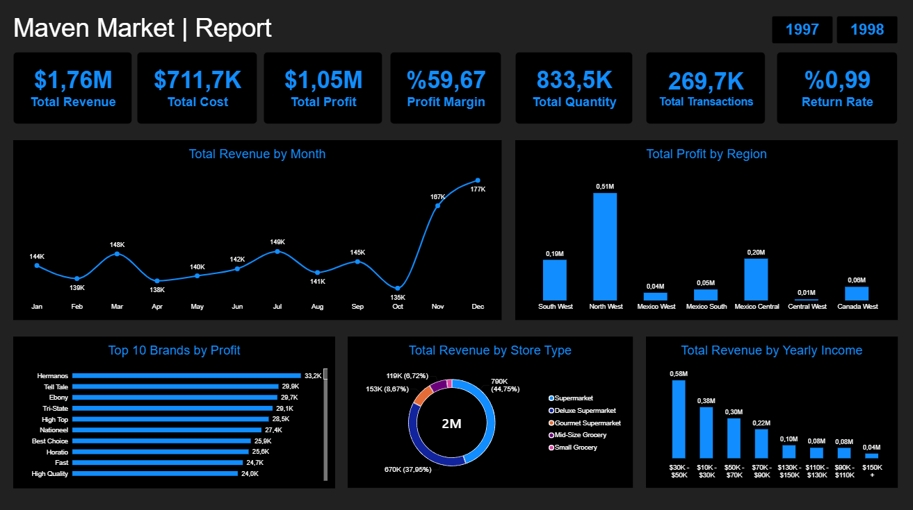

# Maven Market | Sales Dashboard (Power BI)

An interactive Power BI report built on the Maven Market dataset, a fictional grocery chain operating in the USA, Canada and Mexico. The report covers sales in 1997 and 1998 and summarizes revenue, cost, profit, returns, products, stores and customers on a single page.



## Data

7 tables in the final model (8 source tables, the two transaction tables were combined):

| Type | Tables |
|---|---|
| Fact | MM_transactions (1997 and 1998 combined), MavenMarket_Returns_1997-1998 |
| Dimension | MavenMarket_Products, MavenMarket_Customers, MavenMarket_Stores, MavenMarket_Regions, MavenMarket_Calendar |

## What I did

- **Data preparation (Power Query):** appended the 1997 and 1998 transaction tables into one `MM_transactions` table; fixed data types, including decimal prices that were misread because of regional settings (Using Locale, English US); converted `recyclable` and `low_fat` flags to 1/0.
- **Data model:** star schema with one-to-many relationships from Products, Customers, Stores (and Regions via Stores) and Calendar to the fact tables.
- **Calendar:** added Year, Month No and Month Name columns and sorted months in calendar order.
- **DAX measures:**
  - Total Revenue, Total Cost, Total Profit, Profit Margin
  - Total Quantity, Total Transactions
  - Total Returns, Return Rate

```dax
Total Revenue =
SUMX(
    MM_transactions,
    MM_transactions[quantity] * RELATED(MavenMarket_Products[product_retail_price])
)

Total Profit = [Total Revenue] - [Total Cost]

Return Rate = DIVIDE([Total Returns], [Total Quantity])
```

## Report contents

- 7 KPI cards: Total Revenue, Total Cost, Total Profit, Profit Margin, Total Quantity, Total Transactions, Return Rate
- Year slicer (1997 / 1998)
- Total Revenue by Month (line chart)
- Total Profit by Region (bar chart)
- Top 10 Brands by Profit (bar chart)
- Total Revenue by Store Type (donut chart)
- Total Revenue by Yearly Income (column chart)

## Key findings

- Total revenue is **$1.76M** with a profit of **$1.05M**, a profit margin of about **59.7%**.
- The return rate is low, around **1%** of units sold.
- **North West** is the most profitable region (about $0.51M).
- Revenue is highest in **November and December**.
- **Supermarket** stores bring the largest share of revenue (about 45%).
- Customers with a yearly income of **$30K-$50K** generate the most revenue.

## Tools

Power BI Desktop, Power Query, DAX

## Next steps

- Add a second page with customer and product analysis (gender, education, homeowner, top products).
